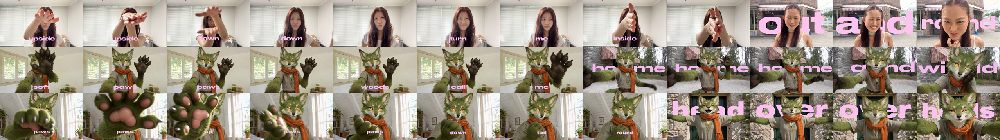
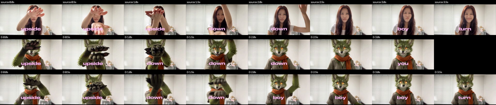

# remix-studio

Two skills and a command-line tool that let a coding agent make video edits on your own machine. The only thing you rent is the model that generates new footage, and you choose which service that is.

- **`remix`** makes a finished edit in the visual language of a reference video. This is our take on Higgsfield Katana.
- **`subject-swap`** puts your character into an existing clip and keeps its shots, camera and timing. This is our take on Higgsfield Genjutsu.

**On our tests, `remix` is competitive with Katana, and `subject-swap` isn't yet as good as Genjutsu.** Details and the side-by-side video are in [Results](#results).

## Install

You need Python 3.11 or newer and ffmpeg (`brew install ffmpeg`).

```bash
./install.sh --dry-run   # shows what would change
./install.sh
```

The installer is safe to re-run. It creates `.venv` in this folder, adds the `remix-studio` command to `~/.local/bin`, and links both skills into every agent it finds. It only adds symlinks, and it won't touch anything already using those names. Because they are symlinks, a `git pull` updates every agent at once.

| Agent | Skills folder | Checked on 2026-11-05 |
|---|---|---|
| Claude Code | `~/.claude/skills` | Both skills loaded |
| Codex | `~/.codex/skills` | Ran `subject-swap` step 1 from another folder |
| Hermes | `~/.hermes/skills/media` | Both listed by `hermes skills list` |
| OpenCode | `~/.config/opencode/skills` | Both listed by `opencode debug skill` |
| Cursor, Gemini, Factory, Kiro, Continue, `~/.agents` | Each agent's own folder | Linked, but not confirmed from inside the agent |

For any other agent, run `.venv/bin/remix-studio install-skills --target /path/to/its/skills`. An agent with no skill system can still run the command directly, so point it at the two `SKILL.md` files.

To remove everything, run `remix-studio uninstall-skills`. It removes only the links that point here.

## Use

Ask in plain words, such as "remix this edit with my character" or "put this fox into this clip". You can also call a skill directly: `/remix` or `/subject-swap` in Claude Code, `$remix` or `$subject-swap` in Codex.

```bash
remix-studio doctor              # what's ready on this machine
remix-studio where               # fonts, music, sound effects and config, as absolute paths
remix-studio analyze  --help     # cuts, flashes, shakes, camera moves, beats, contact sheets
remix-studio edl      --help     # validate and render an edit decision list with ffmpeg
remix-studio gen      --help     # run paid stills and clips under a spend cap
remix-studio swap     --help     # the subject-swap pipeline
remix-studio score    --help     # compare an output with its source or reference
```

Every paid call is held against a spend cap before it's sent. A re-run follows the job it already paid for, and a submit with no clear answer is never blindly resent.

## Connect a generation service

Analysis, rendering, scoring, type, music and sound all run locally and work today. Generating new footage needs a service, and **none is set up for video yet**, so you have one decision to make.

Describe the service in `~/.config/remix-studio/services.json` and use the route `http:<name>`. No code changes are needed. [docs/services.md](docs/services.md) covers every field, and [examples/services.example.json](examples/services.example.json) has starting points for Replicate and fal.

Two things to check when choosing:

- **Subject swap needs a model that accepts a reference video and reference images.** All our results used Seedance 2.5.
- **Content rules can end the job early.** One Seedance route refused our test clip because it showed a realistic person.

`remix` also uses still images for keyframes and location plates. You can supply your own, or generate them through any route.

### What has actually been run

| Path | Status |
|---|---|
| Treg image route, through `remix-studio gen` | Live: one real image, charged $0.005, matching the account balance |
| Any HTTP service (`http:<name>`) | Tested against a local server only. No real provider yet |
| Replicate and fal examples | Written from their public API shapes. **Never run** |
| Video generation on any current route | **Never completed.** Every real clip below came through Higgsfield |

The Higgsfield adapter has been removed from the code. It's kept in git under the tag `baseline-with-higgsfield-adapter`. Your first clip on a new service is therefore a real test, so run one canary and look at it before spending more.

## Results

**Watch: [docs/results/comparison.mp4](docs/results/comparison.mp4)** (76 s, 1080p, side by side and labelled).

These tests ran on 2026-11-05 at 480p, on short clips with no speech or lip sync. Each setup had one attempt, with no fixed seed. Generated clips in both our versions ran through Higgsfield's Seedance 2.5, so they compare the method, not an independent route. Nobody has listened to the audio, and review was of frames rather than playback.

### `remix` vs Katana: competitive

Same reference (the first 8 s of a selfie-style clip), same subject and brief, and a 30-credit cap. The rows are the reference, Katana and ours.



| | Katana | Ours |
|---|---:|---:|
| Finished edit (K1) | Pass | Pass |
| Rhythm matches the reference (K2) | Fail: 0.25 shake bursts/s against 0 | Pass, but it's a weak test on this reference |
| Credits | 28.39 | 25.5 |
| Loudness | -25.8 LUFS | -16.3 LUFS |
| Agent tokens, including cache reads | about 22 M | about 10.3 M |

- **Where ours is better:** it echoes the reference's reach-to-camera hands, while Katana's first scene is nearly static.
- **Where Katana is better:** its fox stays more consistent between scenes, and it can mask subjects with a video segmentation model. Ours has no video masks, face lock, stickers or dissolves.
- **Where both fall short:** both look like clean AI demos, and both split big words around the fox's head. Our critique of ours: floaty slowed spans, no tail, and no payoff at the end.
- **About the tokens:** our first run included fixing ten bugs, and the figure doesn't count building the skill. Neither run is a clean measure of a repeat run.

### `subject-swap` vs Genjutsu: not there yet

Same clip, same subject, one attempt each. On the clip we held back, with the prompt fixed before anything ran, Genjutsu looks better overall.



| Held-back clip (4 s) | Genjutsu | Ours |
|---|---:|---:|
| Tracking score | 0.670 | 0.700 |
| Action beats found | 1 of 2 | 2 of 2 |
| Beat timing error | 0.083 s | 0.125 s (fails G2) |
| Duration | 3.71 s (fails G4) | 4.00 s |
| Credits | 12 | 12 |

- **Genjutsu's advantages:** a sharper, more expressive face, richer fur, and hand beats that stay in order. Our hands smear and arrive late.
- **Our advantages:** exact duration, no time drift, and every caption word kept, though out of order mid-clip.
- **Don't lean on our tracking win:** it's narrow, and it flips to 0.731 for Genjutsu if its clip is retimed to 4 s.
- **Neither reproduced the facial performance** in the last second of the clip.

On the first clip, where the prompt method was developed (so it isn't a fair blind test), ours did better on the numbers:

| First clip (4 s) | Genjutsu replace | Genjutsu motion | Ours |
|---|---:|---:|---:|
| Tracking score | 0.739 | 0.500 | 0.855 |
| Action beats found | 3 of 3 | 2 of 3 | 3 of 3 |
| Beat timing error | 0.222 s | 0.250 s | 0.056 s |
| Duration | 3.71 s | 4.04 s | 4.00 s |

The character was weaker there too. The sheet is at [docs/results/swap-first-clip.png](docs/results/swap-first-clip.png).

### Does it save money?

**Not shown yet.** The subject-swap clips cost the same 12 credits, and the remix saved about 3 credits. Those clips still paid Higgsfield, so the real saving depends on the service you choose. One route that should accept realistic people works out at about $0.95 for 4 s, possibly more than Higgsfield's roughly $0.52 to $0.90 at its published credit prices. The local work (rendering, type, sound and checks) costs nothing per run, but your agent's own usage still does.

The full reports are in [docs/results/](docs/results/), and the acceptance criteria, written before the results, are in [docs/SPEC.md](docs/SPEC.md).

## Layout

```text
skills/remix/          the remix skill, with references, CC0 music and sound, and OFL fonts
skills/subject-swap/   the subject-swap skill
studio/                the Python package behind the remix-studio command
docs/services.md       connecting a generation service
docs/results/          what was measured, and the comparison video
docs/SPEC.md           acceptance criteria
docs/model-routes.md   routes and prices seen on 2026-11-05
examples/              starting points for services.json
tests/                 no test spends money
```

```bash
.venv/bin/python -m pytest -q
```

The suite takes about 3 minutes. Tests that need the original evaluation clips run only when `REMIX_STUDIO_EVAL_CLIPS` points at them.

## Before sharing this publicly

This repo has no remote and no licence yet. Three things need a decision first:

- **Higgsfield's terms.** A third-party summary reports no-reverse-engineering and no-competing-products clauses, which we haven't checked on their live page. This project was built by studying how their products behave, and `skills/remix/references/craft.md` paraphrases lessons learned from them. No Higgsfield scripts are included.
- **Footage in `docs/results/`.** The comparison video and sheets contain a sample clip showing a real person, plus Higgsfield's output. We don't hold rights to these, so remove them from the repo and its history before publishing.
- **Git history.** The `baseline-with-higgsfield-adapter` tag and first commit contain the removed adapter and earlier notes.

Bundled music, sound effects and fonts have their own licences, listed in [skills/remix/assets/LICENSES.md](skills/remix/assets/LICENSES.md).

Use footage and likenesses you have the right to use.
